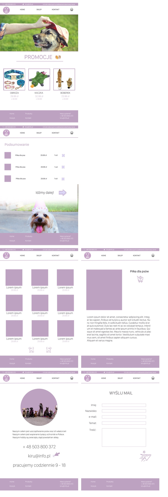

# 🐾 KIRU — pet shop

A small online pet shop built with **Vue.js**.

This is an old project from my **technical high school** days — one of my first bigger
attempts at frontend. I designed the whole thing in Photoshop first, then turned the
mockup into a working app. Back then I had no idea I'd end up being a frontend dev 😄
Keeping it here as a keepsake of my very first steps 💜

---

## 🎨 The design

Before any code, the whole site was designed in Photoshop (`projekt strony.psd`).
Here's a preview of all the views:

<p align="center">
  
</p>

The vibe: soft pastel lilac, lots of animal photos, and a simple, friendly layout.

---

## ✨ What it does

The app is made of a few pages connected with routing:

| View | Description |
|------|-------------|
| **Home** | Landing page with a promo section and featured products |
| **Shop** | Product grid with sorting (by price, by category) |
| **Product** | Single product page with a description and a "others also viewed" section |
| **Cart** | Order summary with a list of products and quantities |
| **Contact** | Contact details and a short bit about the shop |
| **Form** | A "send us a mail" form |

The shared **header** (nav + logo) and **footer** are extracted into their own components.

---

## 🛠️ Built with

- [Vue.js 2](https://v2.vuejs.org/) — frontend framework
- [Vue Router](https://v3.router.vuejs.org/) — routing between pages (`history` mode)
- [SCSS](https://sass-lang.com/) — styling (`scoped` styles in each component)
- [Vue CLI](https://cli.vuejs.org/) — tooling and build
- ESLint — linting

---

## 🚀 Getting started

Install dependencies:
```bash
npm install
```

Run in development (hot-reload):
```bash
npm run serve
```

Production build:
```bash
npm run build
```

Lint:
```bash
npm run lint
```

---

## 📁 Project structure

```
src/
├── assets/icons/     # images and icons (grouped per page)
├── components/       # header.vue, footer.vue
├── views/            # home, sklep, product, koszyk, kontakt, form
├── router/           # Vue Router config
├── App.vue
└── main.js
```

> Note: the code is in Polish (component names, labels) — that's just how I wrote it back then 🙂

---

## 📝 Notes

This is a frontend-only, learning project — the cart, sorting and form are mocked to
show off the layout (no backend). I built it mainly to practice Vue, routing, components
and putting together a responsive UI, going all the way from a Photoshop design to a
working site. First baby steps, kept for the memories.
